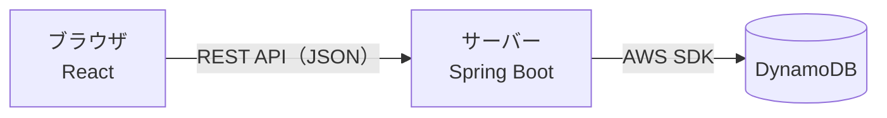
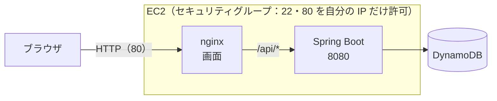

# taskmanagement

Trello 風のタスク管理アプリです。「未着手」「作業中」「完了」の 3 つのリストでカードを管理し、期限切れのカードを赤色で、優先度を自動で表示します。

スクールの課題として、要件定義 → 設計 → 実装 → テストというシステム開発の流れを一通り経験するために作っています。完成後は、自分の仕事や勉強のタスク管理に実際に使います。

## 目次

- [アプリの概要](#アプリの概要)
- [技術スタック](#技術スタック)
- [ドキュメント](#ドキュメント)
- [リポジトリの構成](#リポジトリの構成)
- [開発環境の準備](#開発環境の準備)
- [起動と停止](#起動と停止)
- [API](#api)
- [テスト・コードチェック](#テストコードチェック)
- [AWS へのデプロイ](#aws-へのデプロイ)
- [開発の進め方](#開発の進め方)
- [実装状況](#実装状況)

## アプリの概要

### 前提

| 項目 | 内容 |
| --- | --- |
| 利用者 | 自分ひとり（ログイン・共有機能は不要） |
| 用途 | 仕事のタスクや勉強の進み具合の管理 |
| 動作環境 | パソコン版 Chrome。開発中は自分のパソコン、AWS では EC2 で動かし、自分の PC からだけつなぐ |

### リストとカード

リストは「未着手」「作業中」「完了」の 3 つで固定です。カードには次の項目があります。

| 項目 | 内容 |
| --- | --- |
| タイトル | 必須（1〜50 文字） |
| 説明文 | 任意（500 文字まで） |
| 期限 | 日付と時刻 |
| 時間厳守 | 遅れてはいけないタスクに付ける。優先度が 1 段階上がる |
| 優先度 | 高・中・低の 3 段階。期限の近さと時間厳守から自動で決まる |

### 主な機能

| No. | 機能 | 内容 |
| --- | --- | --- |
| F-01 | ボード表示 | 3 つのリストを横に並べて表示する |
| F-02 | カード追加 | 各リストにカードを追加する |
| F-03 | カード編集 | タイトル・説明文・期限・時間厳守を変更する |
| F-04 | カード削除 | 確認を表示してからカードを削除する（編集ウィンドウの「削除」か、ボードのゴミ箱マークから） |
| F-05 | リスト間の移動 | ドラッグ＆ドロップでカードを別のリストへ移す |
| F-06 | リスト内の並び替え | ドラッグ＆ドロップで同じリスト内の順番を入れ替える |
| F-07 | データ保存 | 変更のたびに DynamoDB へ自動で保存する。ブラウザを閉じても残る |
| F-09 | 期限切れの表示 | 期限を過ぎた未完了のカードを赤色で目立たせる |
| F-10 | 優先度の自動判定 | 期限の近さと時間厳守から優先度を自動で決める |
| F-11 | チェックでの移動 | チェックを付けると、未着手 → 作業中 → 完了へ移す |

各機能のルールは [機能要件](docs/requirements/functional.md) を参照してください。

### 今回は作らないもの

- 優先度・期限での自動並べ替え
- ログイン・他の人との共有、担当者の割り当て
- 複数ボード、リストの追加・名前変更
- リマインド通知（期限の時刻のブラウザ通知）。F-08 は欠番にしています

## 技術スタック



| 区分 | 技術 |
| --- | --- |
| バックエンド | Java 21（OpenJDK 21.0.12）、Spring Boot 4.1.1、AWS SDK for Java 2.57（DynamoDB） |
| バックエンドのビルド | Maven 3.9.16（Maven Wrapper 3.3.4 の `./mvnw` で動かす。Gradle は使わない） |
| フロントエンド | TypeScript 7.0.2、React 19.3.0、Vite 8.3.4、dnd-kit（@dnd-kit/core 6.3.1・@dnd-kit/sortable 10.0.0） |
| フロントエンドのパッケージ管理 | npm 11.19.0（Node.js 24.21.0） |
| データベース | DynamoDB（開発中は DynamoDB Local 3.3.2 を Docker Compose で起動） |
| AWS | EC2（Amazon Linux 2023・Java 21・nginx）、DynamoDB。Terraform で管理 |
| テスト | JUnit 6、Testcontainers 2.0（DynamoDB Local を起動する。バックエンド）／Vitest 5.0、React Testing Library 16.3（フロントエンド） |
| コードチェック | oxlint 1.87、Prettier 3.9 |
| 開発環境 | Colima 0.10.3、Docker 29.8.2、Docker Compose 5.6.0、Git 2.39.5、GitHub CLI 2.101.0 |

Next.js は使わず、React は Vite で作るブラウザだけで動く画面（SPA）にしています。ライブラリごとの詳しいバージョンは [技術スタック](docs/design/tech-stack.md) を参照してください。

## ドキュメント

入口は [要件定義書](docs/requirements.md) です。

| 種類 | ドキュメント | 内容 |
| --- | --- | --- |
| 要件 | [要件定義書](docs/requirements.md) | 背景・目的・スコープ・受け入れ基準・決定事項・未決事項 |
| | [機能一覧](docs/requirements/features.md) | 機能 F-01〜F-11 と、設計・テストとの対応表 |
| | [機能要件](docs/requirements/functional.md) | 各機能が満たすべきルール（入力の文字数、優先度の決め方など） |
| | [画面要件](docs/requirements/screens.md) | 画面 SC-01〜SC-03 で表示する情報とできる操作 |
| | [非機能要件](docs/requirements/non-functional.md) | 対応ブラウザ、応答時間、データの保存先など |
| 設計 | [画面設計](docs/design/screen-design.md) | 画面遷移図と画面レイアウト |
| | [データベース設計](docs/design/database.md) | データの関係と DynamoDB のテーブル定義 |
| | [データフロー](docs/design/data-flow.md) | データの流れ、API 一覧、期限切れ・優先度の判定条件 |
| | [技術スタック](docs/design/tech-stack.md) | 使う技術とバージョン、開発環境、AWS のインフラ構成と主な設定、ファイル構成 |
| テスト | [テスト仕様書](docs/test-spec.md) | 機能と非機能要件を確認する手順 |
| 開発ルール | [CLAUDE.md](CLAUDE.md) | イシュー・ブランチ・PR の進め方、開発サーバーのポート |

## リポジトリの構成

```text
taskmanagement/
├── backend/             … Spring Boot（API・データベースの読み書き）
├── frontend/            … React + TypeScript + Vite（画面）
├── docs/                … 要件定義・設計・テストのドキュメント
├── infra/               … AWS の環境を作る Terraform のコード
├── scripts/             … 開発サーバーの起動・停止、AWS へのデプロイのスクリプト
├── docker-compose.yml   … DynamoDB Local の起動設定
├── index.html ほか       … HTML + CSS + JavaScript のプロトタイプ
├── .claude/             … Claude Code のフック・スキル
└── .github/             … イシュー・PR のテンプレート
```

詳しくは [技術スタックの「ファイル構成」](docs/design/tech-stack.md#3-ファイル構成) を参照してください。

## 開発環境の準備

初回だけ行います。

### 必要なもの

| ツール | 用途 |
| --- | --- |
| Java 21 | バックエンドのビルド・起動（Maven 3.9.16 は `backend/mvnw` が自動で用意する） |
| Node.js 24・npm 11 | フロントエンドの依存関係の追加・ビルド・起動 |
| Colima・Docker・Docker Compose | DynamoDB Local の起動、バックエンドのテスト |
| jq | サンプルデータの投入（`backend/seed/sample-cards.sh`） |
| GitHub CLI（`gh`） | イシュー・PR の作成 |

### Docker（Colima）

Docker は Colima（Docker Desktop を使わずにコマンドだけで動かせる Docker）を使います。

```sh
brew install colima docker docker-compose
```

`~/.docker/config.json` に次を追加し、`docker compose` を使えるようにします。

```json
"cliPluginsExtraDirs": ["/opt/homebrew/lib/docker/cli-plugins"]
```

### フロントエンドの依存関係

```sh
cd frontend
npm install               # 初回と、package.json が変わったときだけ
```

## 起動と停止

### まとめて起動する（おすすめ）

次の 1 コマンドで、DB・バックエンド・フロントエンドをまとめて起動できます。起動したら http://localhost:5173 を開きます。

```sh
scripts/dev-start.sh      # すべて起動（backend / frontend を付けるとそれだけ）
scripts/dev-stop.sh       # バックエンドとフロントエンドを止める
```

| 対象 | URL・ポート |
| --- | --- |
| フロントエンド | http://localhost:5173 |
| バックエンド | http://localhost:8080 |
| DynamoDB Local | http://localhost:8000 |

- ポートがほかのプロセスに使われているときは、そのプロセスを止めてから決められたポートで起動します。フロントエンドは `/api` を 8080 に転送しているため、別のポートでは動かしません
- ログは `.dev/backend.log`・`.dev/frontend.log` に出ます
- DynamoDB のテーブルは、なければバックエンドの起動時に自動で作ります（`LocalTableCreator`）

### 手動で起動する

```sh
colima start              # Docker を起動（Mac を再起動したら毎回必要）
docker compose up -d      # DynamoDB Local を起動
cd backend && ./mvnw spring-boot:run   # バックエンドを起動（http://localhost:8080）
```

別のターミナルでフロントエンドを起動します。

```sh
cd frontend && npm run dev   # フロントエンドを起動（http://localhost:5173）
```

### テストデータの投入

バックエンドを起動したあとに、サンプルのカードを API で投入できます（既存のカードは消えます）。

```sh
backend/seed/sample-cards.sh
```

### データベースを止める

```sh
docker compose down       # 止める（データは残る）
docker compose down -v    # データも消す（元に戻せないので注意）
```

## API

URL はすべて `/api` から始まり、JSON でやり取りします。全体の一覧は [データフロー](docs/design/data-flow.md#3-api-一覧) を参照してください。今使える API は次のとおりです。

| 処理 | メソッド | URL |
| --- | --- | --- |
| カード一覧の取得（リストの表示順 → リスト内の並び順） | GET | `/api/cards` |
| カード 1 件の取得（存在しない id は 404） | GET | `/api/cards/{id}` |
| カードの追加（`title` だけ必須。`listId` を省略すると未着手の一番下に入る） | POST | `/api/cards` |
| カードの編集（タイトル・説明文・期限・時間厳守） | PUT | `/api/cards/{id}` |
| カードの移動・並び替え（`listId` は必須。`position` を省略すると一番下に入る。移動後のカード一覧を返す） | PATCH | `/api/cards/{id}/move` |
| カードの削除（204 を返す。残ったカードの並び順を詰め直す） | DELETE | `/api/cards/{id}` |

```sh
curl http://localhost:8080/api/cards
curl http://localhost:8080/api/cards/1

curl -X POST http://localhost:8080/api/cards \
  -H 'Content-Type: application/json' \
  -d '{"title": "課題A", "description": "第3章", "dueAt": "2026-10-08T18:00:00+09:00", "strict": true, "listId": "todo"}'

curl -X PUT http://localhost:8080/api/cards/1 \
  -H 'Content-Type: application/json' \
  -d '{"title": "課題A（修正）", "description": "第4章", "dueAt": null, "strict": false}'

curl -X PATCH http://localhost:8080/api/cards/1/move \
  -H 'Content-Type: application/json' \
  -d '{"listId": "doing", "position": 0}'

curl -X DELETE http://localhost:8080/api/cards/1
```

- 日時は UTC の ISO 8601 形式（例：`2026-10-09T15:47:41Z`）で返します
- 入力に誤りがあるときは 400 を返し、`{"message": "入力内容に誤りがあります", "errors": {"title": "タイトルを入力してください"}}` の形で項目ごとのエラーを返します
- そのほかのエラー（存在しないカード、id が数字でない、サーバーでのエラーなど）も、同じ形で `message` に理由を入れて返します

## テスト・コードチェック

### バックエンド

テストは Testcontainers で使い捨ての DynamoDB Local を起動します。Colima の場合は次の環境変数が必要です。

```sh
export DOCKER_HOST=unix://$HOME/.colima/default/docker.sock
export TESTCONTAINERS_DOCKER_SOCKET_OVERRIDE=/var/run/docker.sock
cd backend && ./mvnw test
```

### フロントエンド

`frontend/` で次を実行します。

```sh
npm test                  # Vitest（監視モード。1回だけなら npm test -- --run）
npm run lint              # oxlint
npm run format            # Prettier で整形
npm run build             # 型チェックとビルド
```

アプリ全体の確認手順は [テスト仕様書](docs/test-spec.md) にまとめています。

### CI（GitHub Actions）

PR を作ったときと main に push したときに、[`.github/workflows/ci.yml`](.github/workflows/ci.yml) が上のチェックを自動で動かします。

| ジョブ | 動かすもの |
| --- | --- |
| フロントエンド | oxlint、Prettier のチェック、Vitest、型チェックとビルド |
| バックエンド | `./mvnw test`（Testcontainers は GitHub Actions の Docker を使う） |

PR は、両方のジョブが成功してからマージします。

## AWS へのデプロイ

AWS の環境は `infra/` の Terraform で作り、アプリは `scripts/deploy-*.sh` で載せます。マネジメントコンソールでの手作業はしません。EC2 を 1 台だけ置き、画面も API もその中で動かします。データは DynamoDB に保存します。



構成・使うサービス・主な設定・料金の考え方は [技術スタックの「2.5 AWS」](docs/design/tech-stack.md#25-awsインフラ構成) にまとめています。

### 必要なもの

| もの | 用意のしかた |
| --- | --- |
| AWS CLI v2・Terraform 1.10 以上 | `brew install awscli hashicorp/tap/terraform` |
| AWS のプロファイル `taskapp` | 下の「AWS の認証の設定」で作る。ほかの名前にするときは `AWS_PROFILE` を設定する |
| SSH の鍵 `~/.ssh/taskapp-ec2` | `ssh-keygen -t ed25519 -f ~/.ssh/taskapp-ec2`。公開鍵（`.pub`）だけを Terraform が AWS に登録する |
| Java 21・Node.js 24 | jar と画面のビルド（[開発環境の準備](#開発環境の準備)） |

### AWS の認証の設定（初回だけ）

期限のないアクセスキーは使わず、IAM Identity Center（SSO）で数時間だけ有効な認証情報を使います。ここだけはマネジメントコンソールで行います。

1. ルートユーザーと管理者の IAM ユーザーに MFA を設定し、「Budgets」で月 1 ドルなどの予算とメールの通知を作る（料金が増えたときにすぐ気づける）
2. 東京リージョンで IAM Identity Center を有効にし、自分用のユーザーと、許可セット `AdministratorAccess` を作って、自分のアカウントに割り当てる
3. 招待メールからパスワードと MFA を設定し、AWS アクセスポータルの URL（`https://d-xxxxxxxxxx.awsapps.com/start`）を控える
4. ターミナルで `aws configure sso` を実行する。セッション名は `taskapp`、開始 URL は 3 の URL、リージョンは `ap-northeast-1`、ロールは `AdministratorAccess`、プロファイル名は `taskapp` にする
5. `aws sts get-caller-identity --profile taskapp` でアカウント ID が表示されれば完了

認証は数時間で切れます。`Token has expired` などが出たら `aws sso login --profile taskapp` を実行し、ブラウザで承認します（ブラウザの操作が要るので、Claude Code ではなく自分で実行します）。

### 初めて作るとき

```bash
aws sso login --profile taskapp
scripts/infra-init.sh                                   # state 用の S3 バケットを作り、terraform init する（最初に 1 回）
cp infra/terraform.tfvars.example infra/terraform.tfvars  # allowed_ips に自分の PC の IP アドレス（curl -4 https://checkip.amazonaws.com）を書く
cd infra && terraform plan -out=tfplan                  # 作られるものを確認する
terraform apply tfplan                                  # EC2 の中の準備（Java・nginx）は、起動後さらに 2〜3 分かかる
cd .. && scripts/deploy-backend.sh && scripts/deploy-frontend.sh
```

表示される URL（`http://<EC2 の IP アドレス>`）を開き、カードを追加・移動して、再読み込みしても残っていれば完成です。EC2 には `terraform -chdir=infra output -raw ssh_command` で表示されるコマンドで SSH ログインできます（ユーザーは `ec2-user`）。ログインしたら、`java -version`（Java 21）、`systemctl status taskapp nginx`（どちらも `active (running)`）、`curl -s localhost:8080/api/cards`（API が応答する）で中の様子を確かめられます。`allowed_ips` に書いた IP アドレス以外からは、SSH も画面もつながりません。

### コードを変えたあと

| 変えたもの | すること |
| --- | --- |
| `backend/` | `scripts/deploy-backend.sh`（jar をビルドして EC2 に送り、Spring Boot を起動し直す。API が応答するまで待つ） |
| `frontend/` | `scripts/deploy-frontend.sh`（ビルドして EC2 に送り、nginx が配信するファイルを置き換える） |
| `infra/` | `terraform plan` → 作成・変更・削除の件数と、削除（`-`）・作り直し（`-/+`）になるものを確認 → `terraform apply` |

plan で DynamoDB のテーブルが削除・作り直しになっていたら、カードがすべて消えます。EC2 が作り直しになると、送った jar と画面のファイルが消えるので、apply のあとにデプロイし直します。

### EC2 を止める・起動する

使わないあいだは EC2 を止めます。止めている間は、EC2 と IP アドレスの料金がかかりません。

```bash
ID=$(terraform -chdir=infra output -raw instance_id)
aws ec2 stop-instances --instance-ids $ID --profile taskapp    # 止める
aws ec2 start-instances --instance-ids $ID --profile taskapp   # 起動する
```

- 起動し直すと IP アドレスが変わります。`terraform -chdir=infra apply -refresh-only` で読み直してから `terraform -chdir=infra output app_url` で新しい URL を見ます（`scripts/deploy-*.sh` は毎回 AWS に問い合わせるので、そのまま使えます）
- 起動すると Spring Boot と nginx は自動で動き出すので、デプロイし直す必要はありません
- 「終了（terminate）」は EC2 が消えるので選びません

### RDS に EC2 からだけつながることを確かめる

RDS（PostgreSQL）は、課題で求められている接続設定の確認だけに使います（アプリのデータは DynamoDB）。作っている間は料金がかかるので、ふだんは作らず（`enable_rds = false`）、確かめるときだけ作って、終わったら消します。EC2 を起動してから行います。

```bash
cd infra
terraform plan -var=enable_rds=true -out=tfplan   # RDS・サブネットグループ・セキュリティグループの 3 つを作る
terraform apply tfplan                            # 5〜10 分かかる
cd .. && scripts/rds-check.sh                     # 自分の PC からつながらないことと、EC2 から読み書きできることを確かめる
cd infra
terraform plan -out=tfplan                        # 3 つが削除になる
terraform apply tfplan
```

### Claude Code に任せる範囲

AWS の操作は取り返しがつかないものがあるため、`.claude/settings.json` で次のように決めています。あわせて [CLAUDE.md](CLAUDE.md) で、apply の前に plan の結果を見せて承認を取ることにしています。

| 区分 | コマンド |
| --- | --- |
| 自動で実行してよい（読むだけ） | `terraform fmt`・`validate`・`plan`・`output`、`aws sts get-caller-identity` |
| 実行前に確認する（AWS が変わる） | `terraform apply`、`scripts/deploy-*.sh` |
| 実行しない（人が実行する） | `terraform destroy`、`apply -auto-approve`、`apply -destroy`、`state rm` |

### 困ったとき

| 症状 | 原因と対処 |
| --- | --- |
| `Token has expired`、`Error when retrieving token from sso` | 認証が切れている。`aws sso login --profile taskapp` |
| `Backend initialization required` | `terraform init` がまだ。`scripts/infra-init.sh` |
| `allowed_ips` の入力を求められる | `infra/terraform.tfvars` がない。上の「初めて作るとき」の `cp` から |
| `no file exists`（公開鍵） | SSH の鍵 `~/.ssh/taskapp-ec2.pub` がない。`ssh-keygen` で作る |
| SSH や画面がつながらない（タイムアウト） | EC2 が止まっているか、今の IP アドレスが `allowed_ips` にない。`curl -4 https://checkip.amazonaws.com` で調べて `infra/terraform.tfvars` を書き換え、plan → apply |
| `EC2 が止まっています` | `scripts/deploy-*.sh` は EC2 を起動してから実行する |
| `Saved plan is stale` | plan のあとに state が変わった。plan からやり直す |
| `Permission denied (publickey)` | 鍵 `~/.ssh/taskapp-ec2` とユーザー名 `ec2-user` を確かめる |
| `REMOTE HOST IDENTIFICATION HAS CHANGED` | EC2 を作り直して鍵が変わった。`ssh-keygen -R <IP アドレス>` で古い鍵を消す |
| apply の直後に `deploy-backend.sh` が失敗する | EC2 の準備がまだ終わっていない。2〜3 分待ってやり直す |
| 画面が 403・404 になる | 画面をまだ送っていない。`scripts/deploy-frontend.sh` |
| 画面は出るが API が 502 になる | Spring Boot が動いていない。下のログを見る |

ログは EC2 に SSH でログインして見ます。Spring Boot は `sudo journalctl -u taskapp -f`、nginx は `/var/log/nginx/`、EC2 の最初の起動時の準備は `/var/log/cloud-init-output.log` です。

### 費用と後片付け

料金がほぼかからないようにしています（くわしくは [技術スタックの「料金の考え方」](docs/design/tech-stack.md#料金の考え方)）。EC2（t4g.small）は 2026 年 12 月 31 日まで無料で、かかるのは EC2 を動かしている時間の IP アドレスの分と、ディスクの分だけです。2027 年からは EC2 も有料になります。

使わなくなったら、自分で `cd infra && terraform destroy` を実行してすべて消します（**DB のデータも消えます**）。state 用の S3 バケットは Terraform の管理外なので、最後にコンソールで「空にする」→「削除」します。数日後に「Billing and Cost Management」で料金がかかり続けていないか確かめます（「コスト配分タグ」で `Project` を有効にすると、`Project = taskapp` で絞り込めます）。

## 開発の進め方

どんなに小さな変更でも、次の流れで進めます。詳しくは [CLAUDE.md](CLAUDE.md) を参照してください。

1. イシューを作る（`.github/ISSUE_TEMPLATE/` のテンプレートを使う）
2. 最新の main からブランチを切る：`<種別>/<イシュー番号>-<英語の短い説明>`（例：`feature/12-card-drag-and-drop`）
3. コミットする（メッセージは日本語で「何をしたか」を 1 行で）
4. プッシュして PR を作る（本文に `Closes #<イシュー番号>`）
5. 確認してから Squash and merge する

main ブランチへの直接コミット・プッシュは、GitHub のブランチ保護と Claude Code のフックで禁止しています。

## 実装状況

2026年10月10日時点の状況です。

| No. | 機能 | 状況 |
| --- | --- | --- |
| F-01 | ボード表示 | ✅ API から取得したカードを 3 つのリストに表示する |
| F-02 | カード追加 | ✅ 各リストの「＋ タスクを追加」から画面で追加できる |
| F-03 | カード編集 | ✅ カードをクリックして編集できる |
| F-04 | カード削除 | ✅ 編集ウィンドウの「削除」と、ボードのゴミ箱マークから、確認してから削除できる |
| F-05 | リスト間の移動 | ✅ ドラッグ＆ドロップで別のリストの好きな位置へ移せる（空のリストにも移せる） |
| F-06 | リスト内の並び替え | ✅ ドラッグ＆ドロップで順番を入れ替えられる。キーボード（スペースで掴み、矢印で動かす）でも操作できる |
| F-07 | データ保存 | ✅ 追加・編集・削除・移動・並び替えのたびに保存し、再読み込みしても残る |
| F-09 | 期限切れの表示 | ✅ 期限を過ぎた未完了のカードを赤色で表示する |
| F-10 | 優先度の自動判定 | ✅ 画面で優先度を判定して表示する。編集で期限・時間厳守を変えると更新される |
| F-11 | チェックでの移動 | ✅ チェックで 未着手 → 作業中 → 完了 へ移し、完了のチェックを外すと作業中へ戻す |
