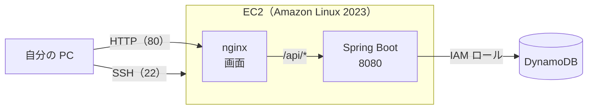
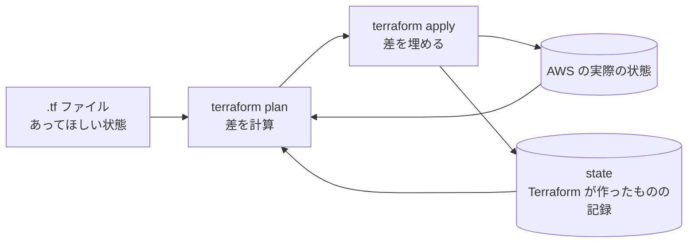

# AWS デプロイ入門ガイド

作成日：2026年11月4日
更新日：2026年11月4日（EC2 を使う構成に変更）

AWS・Terraform を初めて使う人が、このアプリを AWS 上で動かすまでの手順と、その途中で出てくる言葉や考え方をまとめる。コマンドは Claude Code に実行してもらってかまわないが、何が起きているかはこのガイドで理解してから進める。

短い手順だけを見たいときは [README の「AWS へのデプロイ」](../README.md#aws-へのデプロイ) を参照する。

## 目次

1. [このガイドの前提](#1-このガイドの前提)
2. [AWS の基本](#2-aws-の基本)
3. [IaC と Terraform の基本](#3-iac-と-terraform-の基本)
4. [AWS CLI と認証の考え方](#4-aws-cli-と認証の考え方)
5. [認証の設定（初回だけ）](#5-認証の設定初回だけ)
6. [Claude Code に任せる範囲](#6-claude-code-に任せる範囲)
7. [初めてのデプロイ](#7-初めてのデプロイ)
8. [2 回目以降のデプロイ](#8-2-回目以降のデプロイ)
9. [困ったとき](#9-困ったとき)
10. [後片付け](#10-後片付け)

## 1. このガイドの前提

| 項目 | 内容 |
| --- | --- |
| 対象 | AWS・Terraform・IaC を使ったことがない人 |
| ゴール | 自分の PC から SSH で EC2 に入って Java 21 が入っていることを確かめ、ブラウザで EC2 の URL を開くとボードが表示され、カードの追加・移動が保存される |
| 用意するもの | AWS アカウント（管理者の IAM ユーザーでコンソールにログインできる）、Mac、このリポジトリ |
| 必要なツール | AWS CLI v2、Terraform 1.10 以上、Java 21（バックエンドのビルド）、Node.js 24（画面のビルド）（`brew install awscli hashicorp/tap/terraform`） |
| 所要時間 | 認証の設定に 30 分、初回のデプロイに 15 分ほど |
| 費用 | ほぼ 0 円。2026 年 12 月 31 日までは EC2 が無料で、動かしている時間の IP アドレスの分（1 時間 0.005 ドル）とディスクの分（月 0.8 ドルほど）だけかかる（[2.3 料金](#23-料金と構成の選び方)） |

## 2. AWS の基本

### 2.1 クラウドと AWS

AWS（Amazon Web Services）は、サーバー・データベース・ストレージなどをインターネット越しに借りられるサービスである。自分のパソコンの代わりに、Amazon のデータセンターにあるコンピューターでアプリを動かす。

| 言葉 | 意味 |
| --- | --- |
| リージョン | データセンターのある地域。このアプリは東京（`ap-northeast-1`）を使う |
| アベイラビリティゾーン（AZ） | リージョンの中にある、独立したデータセンターの集まり。東京には複数ある |
| 従量課金 | 使った時間・量の分だけ料金がかかる。作ったまま放置すると料金がかかり続ける |
| 責任共有モデル | 建物や物理的な機械は AWS が守り、誰にアクセスを許すか・何を公開するかは利用者が守る |

### 2.2 このアプリで使うサービス



| サービス・仕組み | 役割 | 自分のパソコンでは |
| --- | --- | --- |
| EC2 | 仮想のサーバー。この中で nginx と Spring Boot を動かす。種類は t4g.small（arm64、メモリ 2 GB） | 自分のパソコン |
| nginx | EC2 の入口（80）。画面のファイル（HTML・JS・CSS）を返し、`/api/*` は Spring Boot へ転送する | Vite の開発サーバー（5173）と、その `/api` 転送 |
| Spring Boot | API のサーバー。systemd（Linux でプログラムを起動・管理する仕組み）が起動し、止まったら起動し直す | `./mvnw spring-boot:run`（8080） |
| セキュリティグループ | EC2 のファイアウォール。SSH（22）と HTTP（80）を、自分の PC の IP アドレスからだけ通す。8080 は外に開けない | なし |
| パブリック IP アドレス | インターネットから EC2 につなぐためのアドレス。EC2 を起動するたびに AWS が割り当てるので、止めて起動し直すと変わる | `localhost` |
| キーペア | SSH でログインするための鍵。公開鍵だけを AWS に登録し、秘密鍵（`~/.ssh/taskapp-ec2`）は自分の PC から出さない | なし |
| DynamoDB | AWS が管理するデータベース（キーで項目を読み書きする NoSQL） | Docker Compose の DynamoDB Local（8000） |
| IAM | 「誰が・何を・どこまでできるか」の権限の仕組み | なし |

ネットワーク（VPC・サブネット）は新しく作らず、AWS が最初から用意している **デフォルトの VPC** を使う。

### 2.3 料金と構成の選び方

スクールの課題で EC2 を使う構成が求められているため、EC2 を 1 台だけ置き、画面も API もその中で動かす。料金ができるだけかからないよう、次のようにしている（東京リージョン）。

| もの | 料金 | 減らし方 |
| --- | --- | --- |
| EC2 t4g.small | 2026 年 12 月 31 日までは月 750 時間まで無料（1 台を 24 時間動かしても収まる）。2027 年からは月 16 ドルほど | 使わないあいだは止める。課題が終わったら `terraform destroy` |
| CPU の追加の料金 | 0 円 | `cpu_credits = "standard"` にして、決められた量より多く CPU を使えないようにしている |
| パブリック IPv4 | 動かしている時間だけ、1 時間 0.005 ドル（24 時間動かすと月 3.6 ドル） | 使わないあいだは止める。止めている時間はかからない。止めていてもかかる Elastic IP（固定の IP アドレス）は使わない |
| EBS（ディスク 8 GB） | 月 0.8 ドルほど（止めていてもかかる） | 課題が終わったら `terraform destroy` |
| DynamoDB | 0 円（無料枠の範囲） | 2 つのテーブルで読み込み・書き込み各 12 を確保（[`infra/database.tf`](../infra/database.tf)）。無料枠は各 25 まで |

EC2 を止める・起動するのは、次のコマンドでできる（Terraform の管理する設定は変わらないので、plan に差は出ない）。

```bash
aws ec2 stop-instances --instance-ids $(aws ec2 describe-instances --filters Name=tag:Name,Values=taskapp-app --query 'Reservations[].Instances[].InstanceId' --output text --profile taskapp) --profile taskapp
```

起動するときは `stop-instances` を `start-instances` に変える。起動し直すと IP アドレスが変わるので、`terraform -chdir=infra apply -refresh-only` で新しいアドレスを読み直してから `terraform output` を見る（`scripts/deploy-*.sh` は毎回 AWS に問い合わせるので、そのまま使える）。

次のものは料金や手間を減らすために使っていない。

| 使っていないもの | 理由 | 代わりに使うもの |
| --- | --- | --- |
| RDS（PostgreSQL） | 月 15〜20 ドルほど余分にかかる | DynamoDB |
| ロードバランサー（ALB） | 月 20 ドルほどかかる。EC2 が 1 台なので要らない | nginx |
| 独自のドメインと HTTPS の証明書 | ドメインの料金がかかり、設定も増える | EC2 の IP アドレスに HTTP でつなぐ。セキュリティグループで自分の PC からだけに絞る |
| Elastic IP（固定の IP アドレス） | EC2 を止めていても月 3.6 ドルかかる | 起動のたびに割り当てられる IP アドレス |
| Secrets Manager | 秘密 1 つにつき月 0.4 ドル | DynamoDB は IAM ロールで読み書きするため、パスワードが要らない |

### 2.4 IAM の言葉

| 言葉 | 意味 |
| --- | --- |
| ルートユーザー | アカウントを作ったメールアドレスでのログイン。何でもできるため、普段は使わない |
| IAM ユーザー | アカウントの中に作る利用者。長期間有効なアクセスキーを発行できる |
| IAM ロール | 一時的に借りる権限。EC2 は「DynamoDB のテーブルを読み書きする」ロールを持つ（`infra/backend.tf`）。EC2 にアクセスキーを置かずに済む |
| ポリシー | 許可する操作を書いたもの。ロールやユーザーに付ける |
| IAM Identity Center（SSO） | 人がログインして、短時間だけ有効な認証情報をもらう仕組み。このガイドではこれを使う |

## 3. IaC と Terraform の基本

### 3.1 IaC（Infrastructure as Code）とは

サーバーやネットワークなどのインフラを、マネジメントコンソールでクリックして作る代わりに、**コードに書いて作る** やり方である。

| | コンソールで手作業 | IaC（コード） |
| --- | --- | --- |
| 同じ環境をもう一度作る | 手順を思い出してやり直す | 同じコードを実行する |
| 何を変えたかの記録 | 残らない | Git の履歴に残る |
| 変更前の確認 | できない | `terraform plan` で事前に確認できる |
| レビュー | できない | PR でコードを見てもらえる |
| 消し忘れ | 起きやすい（料金がかかり続ける） | `terraform destroy` でまとめて消せる |
| AI に任せる | 画面操作は難しい | コードとコマンドなので任せやすい |

### 3.2 Terraform の仕組み

Terraform は IaC のツールで、`.tf` ファイルに「こうなっていてほしい状態」を書くと、今の状態との差を埋めるように AWS を操作する。



| 言葉 | 意味 | このリポジトリでは |
| --- | --- | --- |
| provider | どのサービスを操作するかのプラグイン | `hashicorp/aws`（`infra/versions.tf`） |
| resource | 作るもの 1 つ | `resource "aws_instance" "app"` など |
| data | 作らずに読むだけのもの | デフォルトの VPC・サブネット、最新の Amazon Linux 2023 の AMI（OS のイメージ）など |
| variable | 外から渡す値 | `infra/variables.tf`。値は `terraform.tfvars` に書く |
| output | 作ったあとに表示する値 | `infra/outputs.tf`。URL、EC2 の IP アドレス、SSH のコマンド。デプロイスクリプトもここから読む |
| state | Terraform が作ったものの記録（どの AWS のものがどの resource か） | S3 バケット `taskapp-tfstate-<アカウント ID>` に置く |
| lock | 2 人が同時に apply して state を壊さないための鍵 | `use_lockfile = true`（S3 にロックファイルを置く） |

state はパソコンに置くとなくしたときに Terraform が AWS の中身を把握できなくなるため、S3 に置き、過去の版も残している（`scripts/infra-init.sh`）。state には機密が入ることがあるので Git には入れない（`.gitignore`）。

### 3.3 基本のコマンド

| コマンド | すること | AWS が変わるか |
| --- | --- | --- |
| `terraform init` | provider をダウンロードし、state の置き場所につなぐ。最初に 1 回 | 変わらない |
| `terraform fmt` | `.tf` の書き方をそろえる | 変わらない |
| `terraform validate` | 書き方の誤りを調べる | 変わらない |
| `terraform plan` | 何が作られ・変わり・消えるかを表示する | 変わらない |
| `terraform apply` | plan の内容を実行する | **変わる** |
| `terraform output` | output の値を表示する | 変わらない |
| `terraform destroy` | 作ったものをすべて消す | **すべて消える** |

### 3.4 plan の読み方

```text
  ~ resource "aws_security_group" "app" {            # その場で変更する
  - resource "aws_key_pair" "old" { ... }            # 消す
-/+ resource "aws_instance" "app" { ... }            # 消してから作り直す

Plan: 1 to add, 1 to change, 1 to destroy.
```

`-` と `-/+` は特に注意する。DynamoDB のテーブル（`aws_dynamodb_table.cards`・`counters`）が `-` か `-/+` になっていたら、**カードがすべて消える**。EC2（`aws_instance.app`）が `-/+` になると、EC2 の中に送った jar と画面のファイルが消えるので、apply のあとにもう一度デプロイする（`templates/user-data.sh.tftpl` を変えたときなど）。分からないときは apply せずに Claude Code に理由を聞く。

### 3.5 `infra/` のファイル

| ファイル | 作るもの |
| --- | --- |
| `versions.tf` | Terraform・provider の版、state の置き場所、すべてに付けるタグ（`Project = taskapp`） |
| `variables.tf` | 変えられる値（リージョン、許可する IP アドレス、EC2 の種類、SSH の公開鍵のファイル） |
| `database.tf` | DynamoDB のテーブル（カード・連番）。無料枠に収まる容量を確保する |
| `backend.tf` | EC2 とそのセキュリティグループ・IAM ロール・キーペア |
| `outputs.tf` | URL などの表示する値 |
| `templates/user-data.sh.tftpl` | EC2 を最初に起動したときに動くスクリプト。Java 21（Amazon Corretto）と nginx を入れ、Spring Boot を systemd で動かす設定と、nginx の設定を書く |

## 4. AWS CLI と認証の考え方

### 4.1 AWS CLI とは

AWS CLI は、マネジメントコンソールでできる操作をターミナルのコマンドで行うツールである。Terraform も、内部では同じ API を呼んで AWS を操作している。どちらも「誰が操作しているか」を AWS に伝えるために **認証情報** が必要になる。

### 4.2 認証のやり方の比較

| やり方 | 認証情報 | 漏れたとき | このガイド |
| --- | --- | --- | --- |
| ルートユーザーのアクセスキー | 期限なし・全権限 | アカウントを乗っ取られる | 使わない |
| IAM ユーザーのアクセスキー（`aws configure`） | 期限なし。`~/.aws/credentials` に平文で保存 | 無効にするまで使われ続ける | 使わない |
| IAM Identity Center（`aws configure sso`） | ブラウザでログインして、数時間だけ有効なものを受け取る | 時間がたてば使えなくなる | **使う** |

アクセスキーはパソコンのファイルに残るため、うっかり Git に入れたり、AI ツールが読んだりする危険がある。Identity Center なら、パソコンに残るのは期限付きのトークンだけになる。

### 4.3 プロファイル

プロファイルは「どのアカウントに・どの権限で・どのリージョンでつなぐか」に名前を付けたもので、`~/.aws/config` に保存される。このリポジトリのスクリプトは **`taskapp`** という名前を使う（`AWS_PROFILE` で変えられる）。

## 5. 認証の設定（初回だけ）

CLI はまだ認証情報を持っていないので、ここだけはマネジメントコンソールを使う。インフラはこのあとすべて Terraform で作る。

### 5.1 アカウントを守る設定（コンソール）

1. ルートユーザーと、今使っている管理者の IAM ユーザーに MFA（スマートフォンの認証アプリ）が設定されているか確認する。なければ設定する
2. 「Billing and Cost Management」→「Budgets」で、月 1 ドルなどの予算を作り、超えそうなときにメールが届くようにする（EC2 の消し忘れや、設定の誤りで料金が増えたときにすぐ気づける）

### 5.2 IAM Identity Center の準備（コンソール）

管理者の IAM ユーザーでログインして行う。

1. 右上のリージョンを「アジアパシフィック（東京）」にする
2. 「IAM Identity Center」を開き、「有効にする」を押す（組織で有効にするかを聞かれたら、組織のインスタンスを選ぶ）
3. 「ユーザー」→「ユーザーを追加」で、自分用のユーザーを作る（メールアドレスは自分のもの）
4. 「許可セット」→「許可セットを作成」→「事前定義された許可セット」で `AdministratorAccess` を選んで作る
   - Terraform は EC2・DynamoDB・IAM ロールなどを作るため、学習用の個人アカウントでは管理者権限にしておくのが簡単である
5. 「AWS アカウント」→ 自分のアカウントを選び →「ユーザーまたはグループを割り当て」で、3 のユーザーと 4 の許可セットを割り当てる
6. 届いた招待メールからパスワードを設定し、MFA を登録する
7. 「設定」（または ダッシュボード）に表示される **AWS アクセスポータルの URL**（`https://d-xxxxxxxxxx.awsapps.com/start`）を控える

### 5.3 プロファイル `taskapp` を作る（ターミナル）

```bash
aws configure sso
```

質問に次のように答える。

| 質問 | 答え |
| --- | --- |
| `SSO session name (Recommended)` | `taskapp` |
| `SSO start URL` | 5.2 の 7 で控えた URL |
| `SSO region` | `ap-northeast-1` |
| `SSO registration scopes` | 何も入力せず Enter |

ブラウザが開くので、5.2 で作ったユーザーでログインして「許可」を押す。ターミナルに戻ると続きを聞かれる。

| 質問 | 答え |
| --- | --- |
| アカウントの選択 | 自分のアカウント（1 つだけなら自動で選ばれる） |
| ロールの選択 | `AdministratorAccess` |
| `Default client Region` | `ap-northeast-1` |
| `CLI default output format` | `json` |
| `Profile name` | `taskapp` |

### 5.4 つながったか確かめる

```bash
aws sts get-caller-identity --profile taskapp
```

`Account` に 12 桁のアカウント ID、`Arn` に `AWSReservedSSO_AdministratorAccess_...` が表示されれば成功である。

### 5.5 普段の使い方

認証情報は数時間で切れる。`Token has expired` や `Error when retrieving token from sso` が出たら、次を実行してブラウザで承認する（ブラウザの操作が要るので、Claude Code ではなく自分で実行する）。

```bash
aws sso login --profile taskapp
```

今まで IAM ユーザーのアクセスキーを `aws configure` で設定していた場合は、使わなくなったら IAM の画面でそのアクセスキーを無効化・削除しておく。

## 6. Claude Code に任せる範囲

AWS の操作は取り返しがつかないものがあるため、このリポジトリでは Claude Code が勝手に危ない操作をしないよう、`.claude/settings.json` で次のように決めている。

| 区分 | コマンド | 動き |
| --- | --- | --- |
| 自動で実行してよい | `terraform fmt`・`validate`・`plan`・`output`、`aws sts get-caller-identity` | 読むだけ・確認だけなので、確認なしで実行する |
| 実行前に確認する | `terraform apply`、`scripts/deploy-*.sh`、`aws s3 sync`、`aws lambda update-function-code` | AWS が変わるので、毎回ユーザーの許可を求める |
| 実行しない | `terraform destroy`、`apply -auto-approve`、`apply -destroy`、`state rm` | 必要なときはユーザーが自分で実行する |

あわせて [CLAUDE.md](../CLAUDE.md) で、`apply` の前に必ず `plan` を実行し、作成・変更・削除の件数と、削除・作り直しになるものを見せてから承認を取ることにしている。

頼み方の例：

- 「`terraform plan` を実行して、何が作られるか初心者向けに説明して」
- 「plan に `-/+` があるけど、なぜ作り直しになるの？」
- 「plan の内容で問題なければ apply して」
- 「バックエンドだけデプロイして」
- 「EC2 に SSH でつないで、Spring Boot のログからエラーの原因を調べて」

## 7. 初めてのデプロイ

[5. 認証の設定](#5-認証の設定初回だけ) が終わっている前提で、リポジトリの一番上のフォルダで実行する。

### 7.1 ログインする

```bash
aws sso login --profile taskapp
```

### 7.2 Terraform を準備する

```bash
scripts/infra-init.sh
```

state を置く S3 バケット `taskapp-tfstate-<アカウント ID>` がなければ作り（過去の版を残す設定付き）、`terraform init` でそこにつなぐ。最初に 1 回だけ実行する。

### 7.3 つないでよい IP アドレスと、SSH の鍵を用意する

```bash
cp infra/terraform.tfvars.example infra/terraform.tfvars
```

`infra/terraform.tfvars` を開き、`allowed_ips` を自分の PC の IP アドレスに書き換える。このファイルは Git に入らない。今の IP アドレスは次で分かる。

```bash
curl -4 https://checkip.amazonaws.com
```

ここに書いた IP アドレス以外からは、SSH も画面もつながらない（セキュリティグループが通さない）。

続けて、EC2 に SSH でログインするための鍵を作る。秘密鍵 `~/.ssh/taskapp-ec2` は自分の PC に置いたままにし、公開鍵 `~/.ssh/taskapp-ec2.pub` だけを Terraform が AWS に登録する。

```bash
ssh-keygen -t ed25519 -f ~/.ssh/taskapp-ec2
```

### 7.4 作られるものを確認する

```bash
cd infra
terraform plan -out=tfplan
```

初回はすべて新しく作るので `+` だけが並び（EC2・セキュリティグループ・IAM ロール・キーペア・DynamoDB のテーブルなど）、最後に `Plan: N to add, 0 to change, 0 to destroy.` と表示される。`-out=tfplan` で、確認した内容をそのまま次の apply に使えるよう保存する。

### 7.5 作る

```bash
terraform apply tfplan
```

1 分ほどで終わり、`app_url`・`ssh_command` などの output が表示される。EC2 の中では、このあと 2〜3 分かけて Java と nginx が入る（`templates/user-data.sh.tftpl`）。

### 7.6 アプリを載せる

```bash
cd ..
scripts/deploy-backend.sh
scripts/deploy-frontend.sh
```

| スクリプト | すること |
| --- | --- |
| `deploy-backend.sh` | バックエンドの jar をビルドし、SSH で EC2 に送って `/opt/taskapp/taskapp.jar` に置き、Spring Boot（`taskapp.service`）を起動し直す。API が応答するまで待つ |
| `deploy-frontend.sh` | 画面をビルドし、SSH で EC2 に送って、nginx が配信する `/opt/taskapp/frontend` の中身を置き換える |

`apply` の直後で EC2 の準備がまだ終わっていないと、`deploy-backend.sh` が失敗することがある。2〜3 分待ってからもう一度実行する。

### 7.7 SSH でつないで確かめる

```bash
$(terraform -chdir=infra output -raw ssh_command)
```

初めてつなぐときは「この EC2 の鍵を信じてよいか」を聞かれるので `yes` と入力する。ログインできたら、EC2 の中で次を実行する。

| コマンド | 確かめること |
| --- | --- |
| `java -version` | Java 21（Amazon Corretto）が入っている |
| `systemctl status taskapp` | Spring Boot が `active (running)` になっている |
| `systemctl status nginx` | nginx が `active (running)` になっている |
| `curl -s localhost:8080/api/cards` | EC2 の中から API が応答する |
| `exit` | SSH を終える |

### 7.8 開いて確かめる

最後に表示される URL（`http://<EC2 の IP アドレス>`）をブラウザで開く。カードを追加・移動し、再読み込みしても残っていれば完成である。

## 8. 2 回目以降のデプロイ

| 変えたもの | すること |
| --- | --- |
| `backend/` | `scripts/deploy-backend.sh` |
| `frontend/` | `scripts/deploy-frontend.sh` |
| `infra/` | `terraform plan` → 内容を確認 → `terraform apply` |

どれも、先に `aws sso login --profile taskapp` でログインしておく。

## 9. 困ったとき

| 症状 | 原因と対処 |
| --- | --- |
| `Token has expired`、`Error when retrieving token from sso` | 認証が切れている。`aws sso login --profile taskapp` |
| `The config profile (taskapp) could not be found` | プロファイルがない。[5.3](#53-プロファイル-taskapp-を作るターミナル) をやり直す |
| `Backend initialization required` | `terraform init` がまだ。`scripts/infra-init.sh` |
| `allowed_ips` の入力を求められる | `infra/terraform.tfvars` がない。[7.3](#73-つないでよい-ip-アドレスとssh-の鍵を用意する) |
| `Invalid value for "path" parameter: no file exists` | SSH の公開鍵 `~/.ssh/taskapp-ec2.pub` がない。[7.3](#73-つないでよい-ip-アドレスとssh-の鍵を用意する) |
| apply が途中で失敗した | できた分は state に記録されている。原因を直して、もう一度 `plan` → `apply` |
| SSH や画面がつながらない（しばらく待ったあと、タイムアウトになる） | 今の IP アドレスが `allowed_ips` にない。自宅の回線は IP アドレスが変わることがある。`curl -4 https://checkip.amazonaws.com` で調べて `infra/terraform.tfvars` を書き換え、`terraform plan` → `terraform apply` |
| `Saved plan is stale` | plan のあとに state が変わった。`terraform plan -out=tfplan` からやり直す |
| `./mvnw package` が失敗する | Java 21 が入っていない、またはコードがコンパイルできない。ローカルで `cd backend && ./mvnw test` を確かめる |
| `Permission denied (publickey)` | SSH の鍵が違う。`~/.ssh/taskapp-ec2` を使っているか、ユーザー名が `ec2-user` か確かめる |
| `REMOTE HOST IDENTIFICATION HAS CHANGED` | EC2 を作り直したため、EC2 の鍵が変わった。`ssh-keygen -R <EC2 の IP アドレス>` で古い鍵を消してから、つなぎ直す |
| 画面が 403・404 になる | 画面をまだ送っていない。`scripts/deploy-frontend.sh` |
| 画面は出るが API が 502 になる | Spring Boot が起動していない（`deploy-backend.sh` をまだ実行していない、起動に失敗した など）。下の方法でログを見る |

Spring Boot のログは、EC2 に SSH でログインして次で見られる（止めるときは Ctrl + C）。

```bash
sudo journalctl -u taskapp -f
```

nginx のログは `/var/log/nginx/`、EC2 を最初に起動したときの準備のログは `/var/log/cloud-init-output.log` にある。

## 10. 後片付け

EC2 のディスクは止めていても料金がかかり、2027 年からは EC2 も有料になるので、使わなくなったら消しておく。**DB のデータも消える**。Claude Code は実行しないので、自分で実行する。

```bash
cd infra
terraform destroy
```

削除されるものの一覧が表示されるので、確認してから `yes` と入力する。

最後に、Terraform の管理外である state 用のバケットを消す（版を残す設定にしているため、すべての版を消してからバケットを消す）。コンソールの S3 で `taskapp-tfstate-<アカウント ID>` を選び、「空にする」→「削除」を実行する。

数日後に「Billing and Cost Management」で、料金がかかり続けていないか確認する。「コスト配分タグ」で `Project` を有効にしておくと、Cost Explorer でタグ `Project = taskapp` に絞り込み、このアプリの分だけを見られる（有効にしてから反映まで 1 日ほどかかる）。
