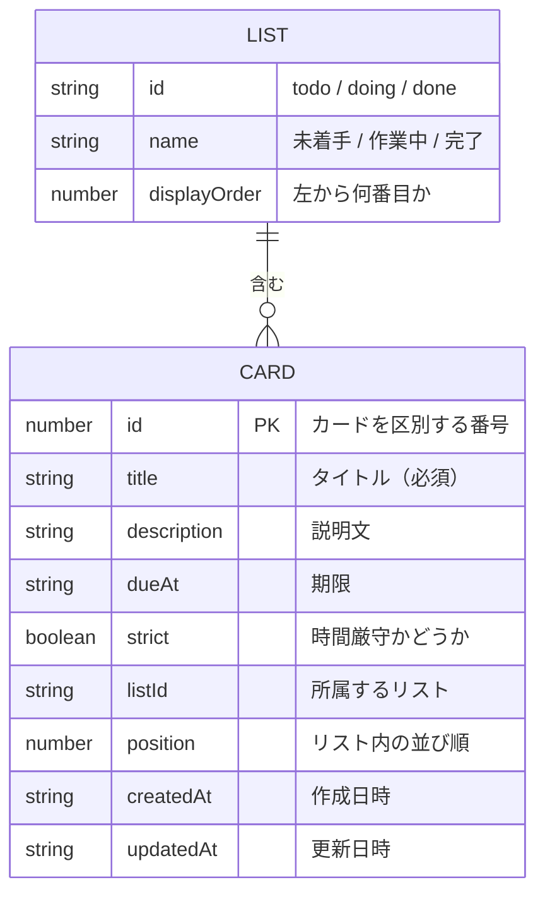

# データベース設計

作成日：2026年10月5日
更新日：2026年10月6日（保存先を localStorage から PostgreSQL に変更）
更新日：2026年10月10日（リマインド通知をやめたため、notified 列を削除）
更新日：2026年11月4日（AWS の無料枠で動かすため、保存先を PostgreSQL から DynamoDB に変更）

アプリで扱うデータの項目と、DynamoDB のテーブル定義をまとめる。

## 1. データ項目

カードは次の項目を持つ。リストは3つ固定のため、利用者が変更できる項目はない。

| 項目 | 必須 | 内容 |
| --- | --- | --- |
| タイトル | 必須 | タスクの名前 |
| 説明文 | 任意 | タスクの詳しい内容やメモ |
| 期限 | 任意 | 日付と時刻。期限切れと優先度の判定にも使う |
| 時間厳守 | 任意 | 遅れてはいけないタスクかどうか。優先度の判定に使う |
| 所属リスト | 自動 | 未着手・作業中・完了 のどれか |
| 表示順 | 自動 | リスト内の並び順 |

入力のルール（文字数など）は [機能要件](../requirements/functional.md) にまとめる。

## 2. データの関係

- 1つのリストには、0枚以上のカードが入る
- 1枚のカードは、必ず1つのリストに入る
- リストは3つで固定。データベースには置かず、バックエンドのコード（`TaskList`）で持つ。アプリから追加・変更・削除はしない

## 3. テーブル定義

DynamoDB は、決まった列を持つ「表」ではなく、キーで探す「項目（item）」の集まりを保存する。項目ごとに持つ属性（列にあたるもの）は自由だが、このアプリではすべてのカードが同じ属性を持つようにする。属性名は Java のクラスと同じキャメルケース（`dueAt` など）で書く。

テーブルは AWS では Terraform（`infra/database.tf`）が作り、ローカルとテストではバックエンドの起動時に自動で作る（`LocalTableCreator`）。

### 3.1 リスト（コードで持つ）

| id | name | displayOrder |
| --- | --- | --- |
| `todo` | 未着手 | 1 |
| `doing` | 作業中 | 2 |
| `done` | 完了 | 3 |

### 3.2 taskapp-cards（カード）

キー（パーティションキー）は `id`。

| 属性名 | 型 | なしでもよいか | 内容 |
| --- | --- | --- | --- |
| id | 数値（N） | 不可 | キー。1 から順に振る（3.3 の連番を使う） |
| title | 文字列（S） | 不可 | タイトル。1〜50文字 |
| description | 文字列（S） | 不可 | 説明文。未入力は空の文字列 |
| dueAt | 文字列（S） | 可 | 期限（UTC の ISO 8601。例：`2026-10-08T09:00Z`）。未入力のときは属性を入れない |
| strict | 真偽値（BOOL） | 不可 | 時間厳守なら `true` |
| listId | 文字列（S） | 不可 | 所属するリストの id（`todo`・`doing`・`done`） |
| position | 数値（N） | 不可 | リスト内の並び順。0 から始まり、上から順に 0, 1, 2 … |
| createdAt | 文字列（S） | 不可 | 作成した日時（UTC の ISO 8601） |
| updatedAt | 文字列（S） | 不可 | 最後に変更した日時（UTC の ISO 8601） |

### 3.3 taskapp-counters（連番）

DynamoDB には PostgreSQL の `IDENTITY` のような自動の連番がないため、数を数える項目を 1 つ置き、カードを追加するたびに 1 増やして id にする。

| 属性名 | 型 | 内容 |
| --- | --- | --- |
| name | 文字列（S） | キー。カードの連番は `card` |
| lastId | 数値（N） | 最後に使った id |

### 3.4 入力チェックと更新のしかた

- タイトルが空や空白だけでないか、文字数、存在するリストかは、バックエンドの入力チェック（Bean Validation・`CardService`）で確かめる。DynamoDB には型や長さの制約を付けられないため
- 期限は日本時間で入力するが、UTC に直して保存する
- 一覧はすべてのカードを読み（Scan）、バックエンドでリストの表示順 → リスト内の並び順に並べる。個人用でカードの枚数が少ないため、並べ替え用の索引は作らない
- 読み込みは「強い整合性」にし、書いた直後の内容を必ず読めるようにする
- カードを別のリストへ移したり、並び替えたり、削除したりしたときは、並び順が変わったカードの `position` を振り直す。1つのトランザクション（`TransactWriteItems`）でまとめて書き、途中で失敗したら元に戻す

優先度は保存しない。時間が経つと変わるため、表示のたびに期限と時間厳守から決める（[データフロー](data-flow.md) の「4. 期限切れ・優先度の判定」）。

## 4. 保存方法

- 保存先は DynamoDB。開発中は自分のパソコンの DynamoDB Local（Docker Compose）、AWS では DynamoDB を使う
- 画面からは直接データベースに触らず、必ずバックエンドの API を通して読み書きする（API の一覧は [データフロー](data-flow.md) の「3. API 一覧」）
- AWS のテーブルは Terraform（`infra/database.tf`）で管理する。マネジメントコンソールで直接変更しない
- AWS の無料枠に収まるよう、テーブルは「プロビジョンド」（決まった量の読み書きを確保する）にし、2 つのテーブルの合計を読み込み・書き込みとも 25 キャパシティユニット以下にしている
