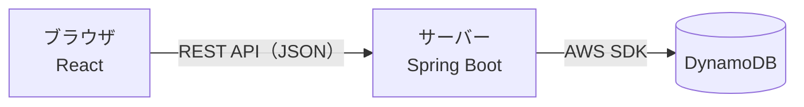

# 技術スタック

作成日：2026年10月5日
更新日：2026年10月6日（バックエンドを Java + Spring Boot、フロントエンドを React、データベースを PostgreSQL に変更）
更新日：2026年10月7日（フロントエンドのコードチェックを ESLint から oxlint に変更。`frontend/` を作成）
更新日：2026年10月10日（各技術のバージョンを追記。ファイル構成を今のリポジトリに合わせる）
更新日：2026年10月10日（リマインド通知をやめたため、Notification API を削除）
更新日：2026年11月4日（AWS の無料枠で動かすため、データベースを PostgreSQL から DynamoDB に変更。AWS の構成を追記）

アプリを作るのに使う技術と、ファイルの構成をまとめる。

## 1. 全体の構成

画面（React）とサーバー（Spring Boot）を分け、データは DynamoDB に保存する。画面とサーバーは REST API（JSON）でやり取りする。



AWS では、EC2 を 1 台置き、画面（nginx）とサーバー（Spring Boot）をその中で動かす（[2.5 AWS](#25-aws)）。

Next.js は今回使わない。React は Vite で作る、ブラウザだけで動く画面（SPA）とする。

## 2. 使う技術

バージョンは 2026年10月10日時点で実際に使っているもの。

- バックエンドのライブラリのバージョンは、Spring Boot（`spring-boot-starter-parent`）がまとめて決める。`pom.xml` に個別のバージョンは書かない。Spring Boot が決めない AWS SDK だけは、`pom.xml` の `aws-sdk.version` で決める
- フロントエンドのライブラリは `package.json` に `^` つきで範囲を書き、実際に入るバージョンは `package-lock.json` で固定する。表には `package-lock.json` のバージョンを書く
- バージョンを上げたときは、この表も合わせて更新する

### 2.1 バックエンド

| 項目 | 内容 | バージョン |
| --- | --- | --- |
| 言語 | Java（LTS） | 21 |
| JDK | OpenJDK（Homebrew で入れたもの） | 21.0.12 |
| フレームワーク | Spring Boot | 4.1.1 |
| ビルドツール | Maven（Gradle は使わない） | 3.9.16 |
| ビルドツールの起動 | Maven Wrapper（`./mvnw`。決まったバージョンの Maven を自動で取ってきて動かすため、Maven を別に入れる必要はない） | 3.3.4 |
| API | Spring Web MVC（REST API） | Spring Boot に含まれるもの |
| データベース操作 | AWS SDK for Java v2（DynamoDB。HTTP は JDK 標準の `url-connection-client` を使う） | 2.57.8 |
| 入力チェック | Bean Validation（Hibernate Validator） | 9.1.3 |
| テスト | JUnit、Mockito、Spring Boot Test、Testcontainers（テスト用の DynamoDB Local を起動する） | JUnit 6.0.3、Mockito 5.23.0、Testcontainers 2.0.5 |

### 2.2 フロントエンド

| 項目 | 内容 | バージョン |
| --- | --- | --- |
| 実行環境 | Node.js | 24.21.0 |
| パッケージ管理 | npm（依存関係は `package-lock.json` で固定する） | 11.19.0 |
| 言語 | TypeScript | 7.0.2 |
| ライブラリ | React（React DOM も同じ） | 19.3.0 |
| ビルドツール・開発サーバー | Vite（React 用プラグイン `@vitejs/plugin-react`） | Vite 8.3.4、プラグイン 6.1.2 |
| ドラッグ＆ドロップ | [dnd-kit](https://dndkit.com/)（`@dnd-kit/core`・`@dnd-kit/sortable`・`@dnd-kit/utilities`） | core 6.3.1、sortable 10.0.0、utilities 3.2.2 |
| サーバーとの通信 | ブラウザ標準の fetch | ― |
| テスト | Vitest、React Testing Library（jsdom 上で動かす） | Vitest 5.0.3、React Testing Library 16.3.3、jsdom 30.1.2 |
| コードのチェック | oxlint | 1.87.0 |
| コードの整形 | Prettier | 3.9.9 |

### 2.3 データベース

| 項目 | 内容 | バージョン |
| --- | --- | --- |
| データベース（AWS） | Amazon DynamoDB（プロビジョンド。無料枠に収まる容量） | ― |
| データベース（開発時・テスト） | DynamoDB Local（AWS が配っている、パソコンで動く DynamoDB） | 3.3.2 |
| Docker イメージ | `amazon/dynamodb-local:3.3.2` | ― |
| 起動方法（開発時） | Docker Compose でコンテナとして起動する。データは Docker のボリューム `dynamodb-data` に残る | Docker Compose 5.6.0 |
| サービス名・テーブル名 | サービス名 `db`、テーブル名 `taskapp-cards`・`taskapp-counters`（バックエンドの起動時に自動で作る） | ― |
| ポート | `8000` | ― |

### 2.4 開発環境

| 項目 | 内容 | バージョン |
| --- | --- | --- |
| エディタ | VSCode（Java と React の拡張機能を入れる） | ― |
| Java | OpenJDK（バックエンドのビルド・起動） | 21.0.12 |
| Node.js・npm | フロントエンドの依存関係の追加・開発サーバーの起動 | Node.js 24.21.0、npm 11.19.0 |
| Docker | Colima（Docker Desktop は使わない） | 0.10.3 |
| | Docker | 29.8.2 |
| | Docker Compose | 5.6.0 |
| バージョン管理 | Git | 2.39.5 |
| GitHub の操作 | GitHub CLI（`gh`。イシュー・PR の作成） | 2.101.0 |
| 開発サーバーの起動 | `scripts/dev-start.sh`・`scripts/dev-stop.sh` で、DynamoDB Local・バックエンド・フロントエンドをまとめて起動・停止する | ― |
| 動作確認 | バックエンドを `http://localhost:8080`、フロントエンドを Vite の開発サーバー `http://localhost:5173` で起動して開く | ― |
| API の呼び出し先 | Vite のプロキシ設定で `/api` をバックエンドに転送する（CORS の設定を不要にするため） | ― |

### 2.5 AWS

スクールの課題で EC2 を使う構成が求められているため、EC2 を 1 台置く。DB は無料枠に収まる DynamoDB を使う。手順は [AWS デプロイ入門ガイド](../aws-deploy-guide.md)。

| 項目 | 内容 | 料金（毎月） |
| --- | --- | --- |
| サーバー | EC2 t4g.micro（arm64、メモリ 1 GB）、Amazon Linux 2023、Amazon Corretto 21。デフォルトの VPC に置く | 約 8 ドル |
| 固定の IP アドレス | Elastic IP | 約 3.6 ドル |
| 入口・画面の配信 | EC2 の中の nginx（80）。`/api/*` は同じ EC2 の Spring Boot（8080）へ転送する | ― |
| 通信の制限 | セキュリティグループで、SSH（22）と HTTP（80）を `allowed_ips` の IP アドレスからだけ許可する | ― |
| Spring Boot の起動 | systemd（`taskapp.service`）。止まったら自動で起動し直す | ― |
| データベース | DynamoDB（プロビジョンド）。EC2 には IAM ロールで読み書きの権限を渡す | 無料枠（読み込み・書き込み各 25 キャパシティユニット、25 GB）の範囲 |
| ディスク | EBS gp3 8 GB | 約 0.8 ドル |
| インフラの管理 | Terraform（AWS プロバイダー 6.71） | ― |

対応ブラウザなどの動作環境は [非機能要件](../requirements/non-functional.md) にまとめる。

## 3. ファイル構成

```text
taskmanagement/
├── README.md
├── CLAUDE.md                    … Claude Code が守る開発ルール
├── docker-compose.yml           … DynamoDB Local の起動設定
├── index.html                   … HTML + CSS + JavaScript のプロトタイプ
├── style.css
├── script.js
├── scripts/                     … 開発サーバーの起動・停止、AWS へのデプロイのスクリプト
│   ├── dev-start.sh
│   ├── dev-stop.sh
│   ├── dev-common.sh
│   ├── infra-init.sh
│   ├── deploy-common.sh
│   ├── deploy-backend.sh
│   └── deploy-frontend.sh
├── infra/                       … AWS の構成（Terraform）
├── backend/                     … Spring Boot のプロジェクト
│   ├── pom.xml
│   ├── mvnw                     … Maven Wrapper
│   ├── seed/sample-cards.sh     … 動作確認用のサンプルデータ（API で入れる）
│   └── src/
│       ├── main/
│       │   ├── java/com/example/taskapp/
│       │   │   ├── card/        … カードとリストの API（Controller・Service・Repository）
│       │   │   ├── common/      … エラー時のレスポンスなど、機能をまたぐ処理
│       │   │   └── dynamodb/    … DynamoDB への接続と、ローカル用のテーブル作成
│       │   └── resources/
│       │       ├── application.yml     … 開発用の設定（DynamoDB Local につなぐ）
│       │       └── application-aws.yml … AWS（EC2）で動かすときの設定
│       └── test/                … API のテスト（Testcontainers で DynamoDB Local を起動する）
├── frontend/                    … React のプロジェクト
│   ├── package.json
│   ├── vite.config.ts           … 開発サーバー（5173）と /api の転送、Vitest の設定
│   └── src/
│       ├── api/                 … サーバーとの通信
│       ├── components/          … 画面の部品（ボード、リスト、カード）
│       ├── domain/              … 画面に依存しない処理（優先度・期限切れの判定など）
│       ├── test/                … テスト用のデータ
│       └── App.tsx
├── .claude/                     … Claude Code の設定（フック・スキル）
├── .github/                     … イシュー・PR のテンプレート
└── docs/
    ├── requirements.md          … 要件定義書（全体のまとめ）
    ├── requirements/
    │   ├── features.md          … 機能一覧
    │   ├── functional.md        … 機能要件
    │   ├── non-functional.md    … 非機能要件
    │   └── screens.md           … 画面要件
    ├── design/
    │   ├── screen-design.md     … 画面設計
    │   ├── database.md          … データベース設計
    │   ├── data-flow.md         … データフロー
    │   └── tech-stack.md        … 技術スタック
    ├── test-spec.md             … テスト仕様書
    └── aws-deploy-guide.md      … AWS デプロイ入門ガイド
```

バックエンドは、層（controller・service など）ごとではなく機能（`card` など）ごとにパッケージを分ける。プロトタイプ（`index.html`・`style.css`・`script.js`）は今はリポジトリの直下にあり、`prototype/` に移す予定。
