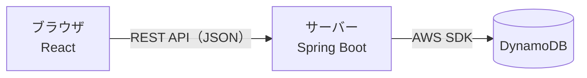
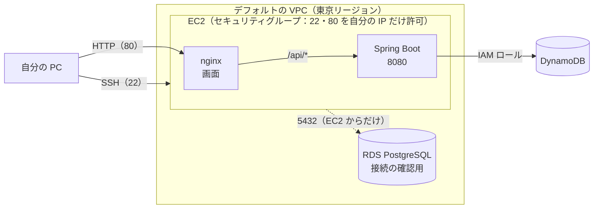

# 技術スタック

作成日：2026年10月5日
更新日：2026年10月6日（バックエンドを Java + Spring Boot、フロントエンドを React、データベースを PostgreSQL に変更）
更新日：2026年10月7日（フロントエンドのコードチェックを ESLint から oxlint に変更。`frontend/` を作成）
更新日：2026年10月10日（各技術のバージョンを追記。ファイル構成を今のリポジトリに合わせる）
更新日：2026年10月10日（リマインド通知をやめたため、Notification API を削除）
更新日：2026年11月4日（AWS の無料枠で動かすため、データベースを PostgreSQL から DynamoDB に変更。AWS の構成を追記）
更新日：2026年11月4日（AWS デプロイ入門ガイドから、インフラ構成・設定・Terraform での管理と、`infra/`・`scripts/` のファイル構成を移す）

アプリを作るのに使う技術と、ファイルの構成をまとめる。

## 1. 全体の構成

画面（React）とサーバー（Spring Boot）を分け、データは DynamoDB に保存する。画面とサーバーは REST API（JSON）でやり取りする。



AWS では、EC2 を 1 台置き、画面（nginx）とサーバー（Spring Boot）をその中で動かす（[2.5 AWS（インフラ構成）](#25-awsインフラ構成)）。

Next.js は今回使わない。React は Vite で作る、ブラウザだけで動く画面（SPA）とする。

## 2. 使う技術

バージョンは 2026年10月10日時点で実際に使っているもの。

- バックエンドのライブラリのバージョンは、Spring Boot（`spring-boot-starter-parent`）がまとめて決める。`pom.xml` に個別のバージョンは書かない。Spring Boot が決めない AWS SDK だけは、`pom.xml` の `aws-sdk.version` で決める
- フロントエンドのライブラリは `package.json` に `^` つきで範囲を書き、実際に入るバージョンは `package-lock.json` で固定する。表には `package-lock.json` のバージョンを書く
- バージョンを上げたときは、この表も合わせて更新する

### 2.1 バックエンド

| 項目 | 内容 | バージョン |
| --- | --- | --- |
| 言語 | Java（LTS） | 21 |
| JDK | OpenJDK（Homebrew で入れたもの） | 21.0.12 |
| フレームワーク | Spring Boot | 4.1.1 |
| ビルドツール | Maven（Gradle は使わない） | 3.9.16 |
| ビルドツールの起動 | Maven Wrapper（`./mvnw`。決まったバージョンの Maven を自動で取ってきて動かすため、Maven を別に入れる必要はない） | 3.3.4 |
| API | Spring Web MVC（REST API） | Spring Boot に含まれるもの |
| データベース操作 | AWS SDK for Java v2（DynamoDB。HTTP は JDK 標準の `url-connection-client` を使う） | 2.57.8 |
| 入力チェック | Bean Validation（Hibernate Validator） | 9.1.3 |
| テスト | JUnit、Mockito、Spring Boot Test、Testcontainers（テスト用の DynamoDB Local を起動する） | JUnit 6.0.3、Mockito 5.23.0、Testcontainers 2.0.5 |

### 2.2 フロントエンド

| 項目 | 内容 | バージョン |
| --- | --- | --- |
| 実行環境 | Node.js | 24.21.0 |
| パッケージ管理 | npm（依存関係は `package-lock.json` で固定する） | 11.19.0 |
| 言語 | TypeScript | 7.0.2 |
| ライブラリ | React（React DOM も同じ） | 19.3.0 |
| ビルドツール・開発サーバー | Vite（React 用プラグイン `@vitejs/plugin-react`） | Vite 8.3.4、プラグイン 6.1.2 |
| ドラッグ＆ドロップ | [dnd-kit](https://dndkit.com/)（`@dnd-kit/core`・`@dnd-kit/sortable`・`@dnd-kit/utilities`） | core 6.3.1、sortable 10.0.0、utilities 3.2.2 |
| サーバーとの通信 | ブラウザ標準の fetch | ― |
| テスト | Vitest、React Testing Library（jsdom 上で動かす） | Vitest 5.0.3、React Testing Library 16.3.3、jsdom 30.1.2 |
| コードのチェック | oxlint | 1.87.0 |
| コードの整形 | Prettier | 3.9.9 |

### 2.3 データベース

| 項目 | 内容 | バージョン |
| --- | --- | --- |
| データベース（AWS） | Amazon DynamoDB（プロビジョンド。無料枠に収まる容量） | ― |
| データベース（開発時・テスト） | DynamoDB Local（AWS が配っている、パソコンで動く DynamoDB） | 3.3.2 |
| Docker イメージ | `amazon/dynamodb-local:3.3.2` | ― |
| 起動方法（開発時） | Docker Compose でコンテナとして起動する。データは Docker のボリューム `dynamodb-data` に残る | Docker Compose 5.6.0 |
| サービス名・テーブル名 | サービス名 `db`、テーブル名 `taskapp-cards`・`taskapp-counters`（バックエンドの起動時に自動で作る） | ― |
| ポート | `8000` | ― |

### 2.4 開発環境

| 項目 | 内容 | バージョン |
| --- | --- | --- |
| エディタ | VSCode（Java と React の拡張機能を入れる） | ― |
| Java | OpenJDK（バックエンドのビルド・起動） | 21.0.12 |
| Node.js・npm | フロントエンドの依存関係の追加・開発サーバーの起動 | Node.js 24.21.0、npm 11.19.0 |
| Docker | Colima（Docker Desktop は使わない） | 0.10.3 |
| | Docker | 29.8.2 |
| | Docker Compose | 5.6.0 |
| バージョン管理 | Git | 2.39.5 |
| GitHub の操作 | GitHub CLI（`gh`。イシュー・PR の作成） | 2.101.0 |
| 開発サーバーの起動 | `scripts/dev-start.sh`・`scripts/dev-stop.sh` で、DynamoDB Local・バックエンド・フロントエンドをまとめて起動・停止する | ― |
| 動作確認 | バックエンドを `http://localhost:8080`、フロントエンドを Vite の開発サーバー `http://localhost:5173` で起動して開く | ― |
| API の呼び出し先 | Vite のプロキシ設定で `/api` をバックエンドに転送する（CORS の設定を不要にするため） | ― |
| AWS の操作 | AWS CLI v2（認証は IAM Identity Center） | 2.38.5 |
| インフラの管理 | Terraform（AWS プロバイダー） | Terraform 1.17.0、AWS プロバイダー 6.71.0 |

### 2.5 AWS（インフラ構成）

スクールの課題で EC2 を使う構成が求められているため、EC2 を 1 台置き、画面（nginx）も API（Spring Boot）もその中で動かす。データは DynamoDB に保存する。AWS の環境はすべて `infra/` の Terraform で作り、マネジメントコンソールでの手作業はしない。作り方・デプロイの手順は [README の「AWS へのデプロイ」](../../README.md#aws-へのデプロイ) にまとめる。

ここには構成と主な設定だけを書く。細かい設定値（容量・メモリ・バージョンなど）は変わることがあるので、`infra/` のコードを正とする。

#### 構成図



#### 使うサービスと役割

| サービス・仕組み | 役割 | 開発中（自分のパソコン）では |
| --- | --- | --- |
| VPC・サブネット | ネットワーク。新しく作らず、AWS が最初から用意しているデフォルトの VPC を使う | なし |
| EC2 | 仮想のサーバー。nginx と Spring Boot を動かす | 自分のパソコン |
| nginx | EC2 の入口（80）。画面のファイル（HTML・JS・CSS）を返し、`/api/*` は Spring Boot へ転送する | Vite の開発サーバー（5173）と、その `/api` 転送 |
| Spring Boot | API のサーバー（8080）。systemd のサービス `taskapp` として動かし、止まったら起動し直す | `./mvnw spring-boot:run`（8080） |
| セキュリティグループ | EC2・RDS のファイアウォール | なし |
| パブリック IP アドレス | インターネットから EC2 につなぐためのアドレス。起動のたびに AWS が割り当てるので、止めて起動し直すと変わる | `localhost` |
| キーペア | SSH でログインするための鍵。公開鍵だけを AWS に登録し、秘密鍵は自分の PC から出さない | なし |
| IAM ロール | EC2 に DynamoDB を読み書きする権限を渡す。EC2 にアクセスキーを置かずに済む | なし（DynamoDB Local は認証なし） |
| DynamoDB | アプリのデータ（カード・連番）を保存する | Docker Compose の DynamoDB Local（8000） |
| RDS（PostgreSQL） | 課題で求められている RDS の接続設定の確認用。アプリのデータは置かない。ふだんは作らない | なし |
| Secrets Manager | RDS を作っている間だけ、RDS のパスワードを置く（RDS が作って管理する） | なし |
| S3 | Terraform の state（作ったものの記録）を置く | なし |

#### 主な設定

| 項目 | 設定 |
| --- | --- |
| リージョン | 東京（`ap-northeast-1`） |
| EC2 | Amazon Linux 2023（arm64）、t4g.small。最初の起動時に、Java 21（Amazon Corretto）と nginx を入れ、Spring Boot のサービスと nginx の設定を書く（`infra/templates/user-data.sh.tftpl`）。アプリの jar と画面のファイルは、あとから `scripts/deploy-*.sh` が SSH で送る |
| EC2 への通信 | セキュリティグループで、SSH（22）と HTTP（80）を `allowed_ips` に書いた IP アドレス（自分の PC）からだけ許可する。8080 は外に開けない。EC2 から外への通信（パッケージのインストール、DynamoDB への接続）はすべて許可する |
| RDS への通信 | RDS のセキュリティグループで、5432 を EC2 のセキュリティグループからだけ許可する（IP アドレスでは許可しない）。インターネットからつなぐためのアドレスも持たせない |
| 権限 | EC2 の IAM ロールには、2 つの DynamoDB テーブルの読み書きに要る操作だけを許可する |
| 守り | EC2 のメタデータは IMDSv2 だけを許可する。EC2・RDS のディスクは暗号化する。RDS のパスワードはコードにも state にも残さない |
| DynamoDB | テーブルは `taskapp-cards`（カード）と `taskapp-counters`（id の連番）。無料枠に収まるよう、容量を決めて確保する「プロビジョンド」にする |
| RDS | PostgreSQL、db.t4g.micro、1 台だけ（Multi-AZ・バックアップなし）。変数 `enable_rds` が `true` のときだけ作り、すぐ消せる設定にする |

#### 料金の考え方

料金ができるだけかからないようにしている。金額は目安で、AWS の料金や無料枠が変わることがある。

| もの | 料金 | 減らし方 |
| --- | --- | --- |
| EC2（t4g.small） | 2026 年 12 月 31 日までは無料（AWS の無料トライアル）。2027 年からは有料 | 使わないあいだは止める。課題が終わったら消す |
| CPU の追加の料金 | かからない | CPU を決められた量より多く使えない設定（`cpu_credits = "standard"`）にしている |
| パブリック IPv4 | EC2 を動かしている時間だけかかる | 使わないあいだは EC2 を止める |
| EBS（EC2 のディスク） | 止めていてもかかる（月 1 ドル未満） | 課題が終わったら消す |
| DynamoDB | 無料枠の範囲 | 無料枠に収まる容量だけを確保する |
| RDS | 作っている時間だけかかる | ふだんは作らず、確認するときだけ作って、終わったら消す |

次のものは、料金や手間を減らすために使っていない。

| 使っていないもの | 理由 | 代わりに使うもの |
| --- | --- | --- |
| RDS をアプリの DB にすること | 動かしている間ずっと料金がかかる。止めても 7 日たつと自動で起動する | DynamoDB |
| ロードバランサー（ALB） | 料金がかかる。EC2 が 1 台なので要らない | nginx |
| 独自のドメインと HTTPS の証明書 | ドメインの料金がかかり、設定も増える | EC2 の IP アドレスに HTTP でつなぐ。セキュリティグループで自分の PC からだけに絞る |
| Elastic IP（固定の IP アドレス） | EC2 を止めていても料金がかかる | 起動のたびに割り当てられる IP アドレス |
| NAT ゲートウェイ・専用の VPC | 料金と設定が増える。EC2 が 1 台なので要らない | デフォルトの VPC |

#### Terraform での管理

| 項目 | 内容 |
| --- | --- |
| state の置き場所 | S3 のバケット `taskapp-tfstate-<アカウント ID>`。過去の版を残し、S3 のロックファイルで同時に apply できないようにする。バケットは `scripts/infra-init.sh` が作る（Terraform の管理外） |
| 環境ごとの値 | `infra/terraform.tfvars` に書く（つないでよい IP アドレスなど）。Git には入れない。書き方は `terraform.tfvars.example` |
| タグ | 作ったものすべてに `Project = taskapp`・`ManagedBy = terraform` を付け、請求をこのアプリの分だけに絞り込めるようにする |
| 変更の進め方 | `terraform plan` で作成・変更・削除の件数と、削除・作り直しになるものを確かめてから `terraform apply` する。`terraform destroy` は人が実行する（[CLAUDE.md](../../CLAUDE.md)） |
| 品質チェック | `terraform fmt`・`validate`・`plan` と、セキュリティ・料金の観点の確認（`.claude/skills/quality-check/SKILL.md`） |
| AWS の認証 | IAM Identity Center（SSO）のプロファイル `taskapp`。数時間だけ有効な認証情報を使い、期限のないアクセスキーは使わない |

対応ブラウザなどの動作環境は [非機能要件](../requirements/non-functional.md) にまとめる。

## 3. ファイル構成

```text
taskmanagement/
├── README.md
├── CLAUDE.md                    … Claude Code が守る開発ルール
├── docker-compose.yml           … DynamoDB Local の起動設定
├── index.html                   … HTML + CSS + JavaScript のプロトタイプ
├── style.css
├── script.js
├── scripts/                     … 開発サーバーの起動・停止、AWS へのデプロイのスクリプト
│   ├── dev-start.sh             … DynamoDB Local・バックエンド・フロントエンドを起動する
│   ├── dev-stop.sh              … バックエンド・フロントエンドを止める
│   ├── dev-common.sh            … dev-*.sh が読み込む共通の設定（決められたポート）
│   ├── infra-init.sh            … state 用の S3 バケットを作り、terraform init する（最初に 1 回）
│   ├── deploy-common.sh         … deploy-*.sh が読み込む共通の設定（EC2 の今の IP アドレスを調べる）
│   ├── deploy-backend.sh        … jar をビルドして EC2 に送り、Spring Boot を起動し直す
│   ├── deploy-frontend.sh       … 画面をビルドして EC2 に送り、nginx が配信するファイルを置き換える
│   └── rds-check.sh             … RDS に EC2 からだけ接続できることを確かめる
├── infra/                       … AWS の構成（Terraform）
│   ├── versions.tf              … Terraform・プロバイダーの版、state の置き場所、すべてに付けるタグ
│   ├── variables.tf             … 変えられる値（リージョン、つないでよい IP アドレス、EC2 の種類、enable_rds など）
│   ├── backend.tf               … EC2 とそのセキュリティグループ・IAM ロール・キーペア
│   ├── database.tf              … DynamoDB のテーブル
│   ├── rds.tf                   … RDS（接続の確認用）とそのセキュリティグループ
│   ├── outputs.tf               … URL・SSH のコマンドなど、apply のあとに表示する値
│   ├── templates/
│   │   └── user-data.sh.tftpl   … EC2 の最初の起動時に動くスクリプト（Java・nginx を入れ、起動の設定を書く）
│   ├── terraform.tfvars.example … terraform.tfvars（Git に入れない）の書き方
│   └── .terraform.lock.hcl      … プロバイダーの版の固定
├── backend/                     … Spring Boot のプロジェクト
│   ├── pom.xml
│   ├── mvnw                     … Maven Wrapper
│   ├── seed/sample-cards.sh     … 動作確認用のサンプルデータ（API で入れる）
│   └── src/
│       ├── main/
│       │   ├── java/com/example/taskapp/
│       │   │   ├── card/        … カードとリストの API（Controller・Service・Repository）
│       │   │   ├── common/      … エラー時のレスポンスなど、機能をまたぐ処理
│       │   │   └── dynamodb/    … DynamoDB への接続と、ローカル用のテーブル作成
│       │   └── resources/
│       │       ├── application.yml     … 開発用の設定（DynamoDB Local につなぐ）
│       │       └── application-aws.yml … AWS（EC2）で動かすときの設定
│       └── test/                … API のテスト（Testcontainers で DynamoDB Local を起動する）
├── frontend/                    … React のプロジェクト
│   ├── package.json
│   ├── vite.config.ts           … 開発サーバー（5173）と /api の転送、Vitest の設定
│   └── src/
│       ├── api/                 … サーバーとの通信
│       ├── components/          … 画面の部品（ボード、リスト、カード）
│       ├── domain/              … 画面に依存しない処理（優先度・期限切れの判定など）
│       ├── test/                … テスト用のデータ
│       └── App.tsx
├── .claude/                     … Claude Code の設定
│   ├── settings.json            … 自動で実行してよい・確認する・実行しないコマンド
│   ├── hooks/                   … main への直接コミット、決められていないポートでの起動を止める
│   └── skills/                  … 開発サーバーの起動（dev-servers）、品質チェック（quality-check）
├── .github/                     … イシュー・PR のテンプレート
└── docs/
    ├── requirements.md          … 要件定義書（全体のまとめ）
    ├── requirements/
    │   ├── features.md          … 機能一覧
    │   ├── functional.md        … 機能要件
    │   ├── non-functional.md    … 非機能要件
    │   └── screens.md           … 画面要件
    ├── design/
    │   ├── screen-design.md     … 画面設計
    │   ├── database.md          … データベース設計
    │   ├── data-flow.md         … データフロー
    │   └── tech-stack.md        … 技術スタック
    └── test-spec.md             … テスト仕様書
```

バックエンドは、層（controller・service など）ごとではなく機能（`card` など）ごとにパッケージを分ける。プロトタイプ（`index.html`・`style.css`・`script.js`）は今はリポジトリの直下にあり、`prototype/` に移す予定。
